# Bindizr UI

<p>
    <a href="https://github.com/kweonminsung/bindizr-ui/actions/workflows/ci.yml">
        
    </a>
    <a href="https://github.com/netbirdio/netbird/blob/main/LICENSE">
        
    </a>
    <a href="https://github.com/kweonminsung/bindizr/releases/tag/v0.1.0">
        
    </a>
</p>

A web interface for [Bindizr](https://github.com/kweonminsung/bindizr): manage DNS zones and records, sign and synchronize zones, and delegate access through roles.

[Features](#features) · [Roles and credentials](#roles-and-credentials) · [Audit log](#audit-log) · [Run with Docker](#run-with-docker) · [Getting Started](#getting-started)

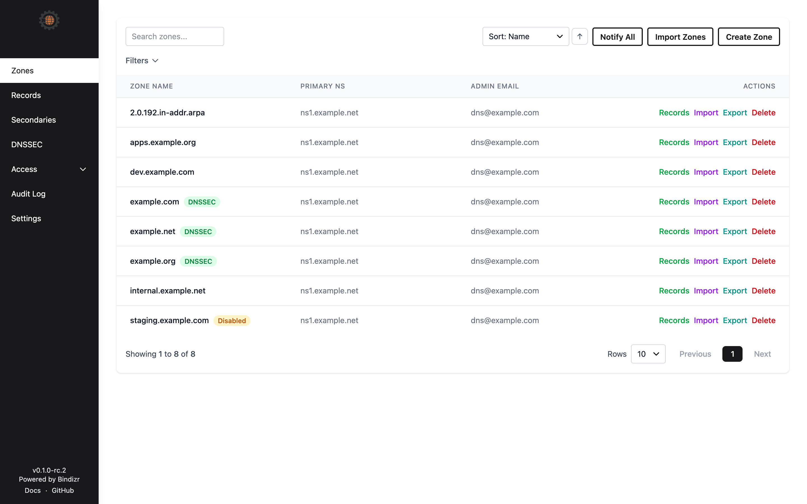

## Features

Work with DNS data in **Zones** and **Records**, then manage signing in **DNSSEC** and propagation in **Secondaries**. Use [roles](#roles-and-credentials) to delegate these operations and the [audit log](#audit-log) to review administrative changes. Screenshots show a running instance with example data.

### Zone and record management

Create zones, configure their SOA settings, and manage records and TTLs. Search, filter, and sort the listings, or include generated DNSSEC records when inspecting a signed zone.

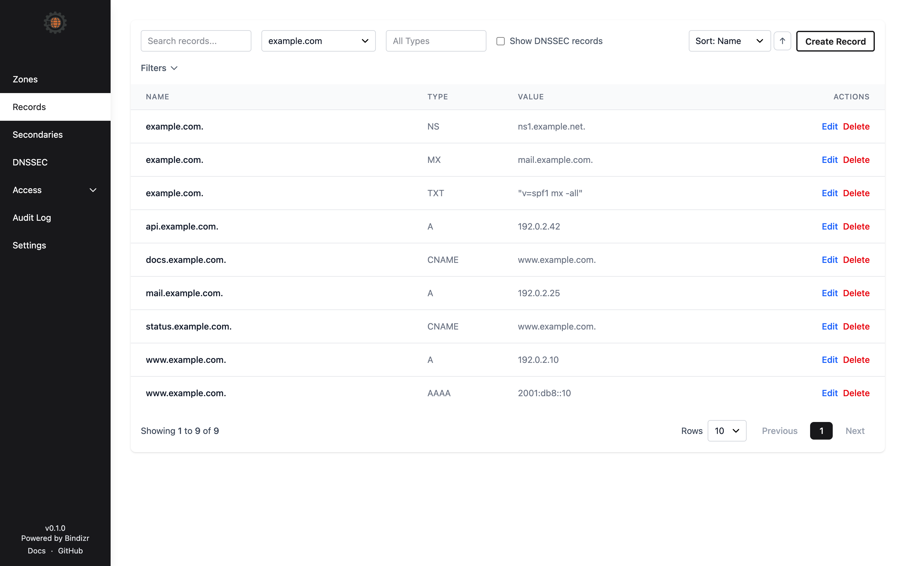

### Zone import and export

Bring in a BIND zone file, a zone over AXFR, or multiple zones from a server or catalog. Validate **append**, **upsert**, or **replace** imports before applying them, and copy or download exports with or without DNSSEC records.

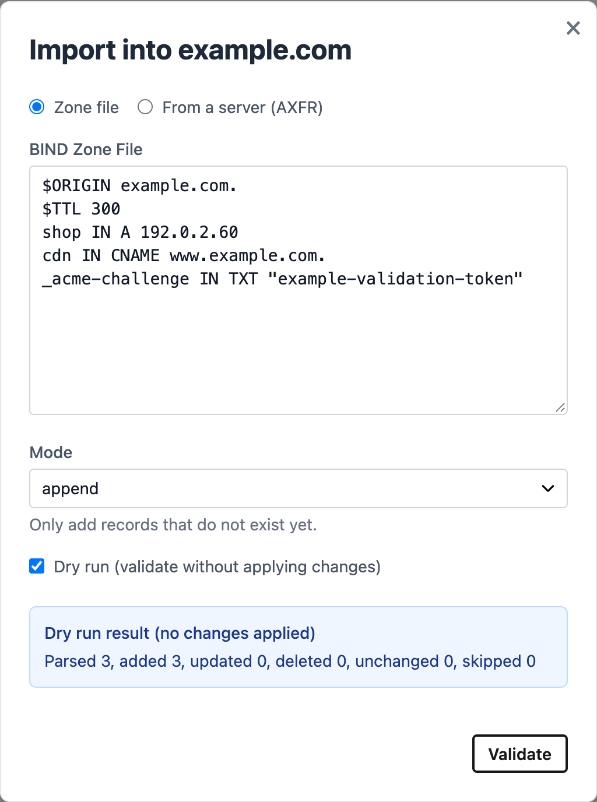

### Version history and rollback

Review changes by SOA serial and author, compare record differences, and preview rollbacks. Restoring a version advances the serial for secondary synchronization.

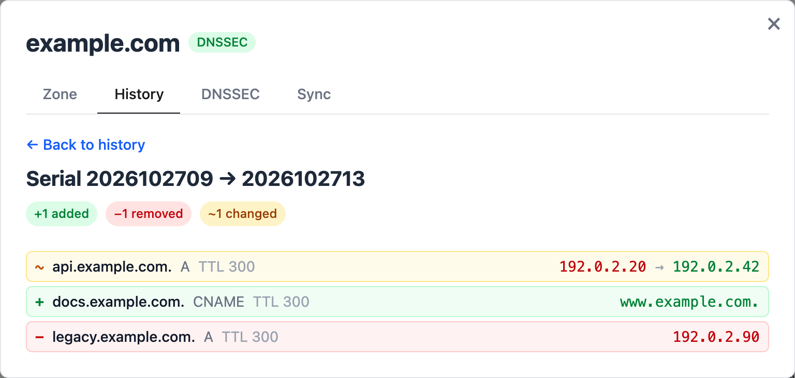

### DNSSEC signing and policies

Use the DNSSEC overview to check signed zones, then open a zone to inspect its signatures and keys. Apply reusable signing policies, manage rollovers, and copy or check the DS records published by the parent zone.

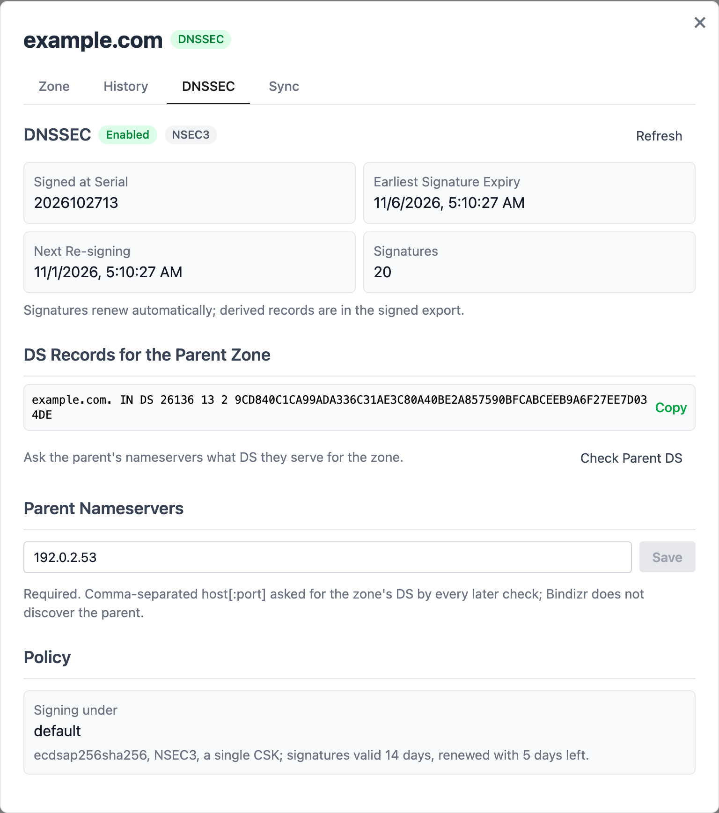

### Secondary synchronization

Register secondary servers, select a TSIG key for signed NOTIFY, and pause a server without removing it. Check serials and reachability, inspect AXFR/IXFR transfer history, or send NOTIFY for one or all zones, optionally advancing the serial.

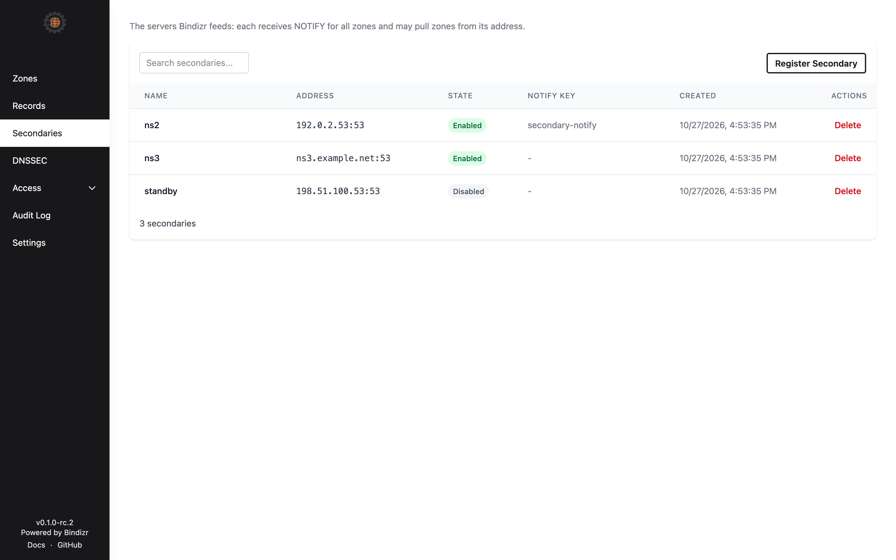

## Roles and credentials

Roles hold permissions; API tokens and TSIG keys act under a role. Start in **Access → Roles**, define what a role may do, then issue the credentials that will use those permissions.

### 1. Create a role for each purpose

Separate application deployments from secondary transfers with roles such as `deployment` and `zone-transfers`. The list shows each role's grant, token and key counts; a new role permits nothing until grants are added.

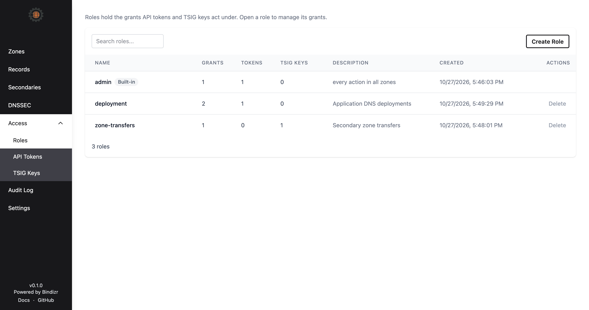

### 2. Grant only the required actions

Open the role's **Add Grant** tab and choose actions for one zone or all zones. Record grants can also restrict names and types: this example allows `A` and `AAAA` records under `*.apps` in `example.com`.

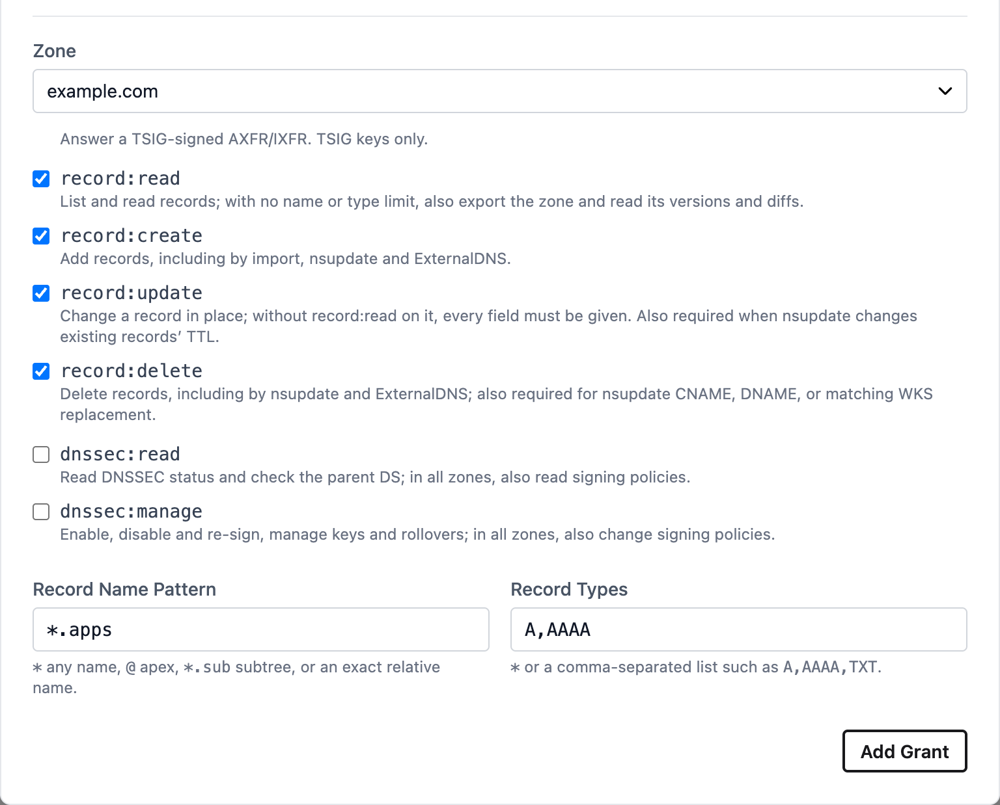

### 3. Issue tokens and keys in that role

Use the role's **API Tokens** and **TSIG Keys** tabs to create and review its credentials. Changing the role's grants changes what those credentials may do.

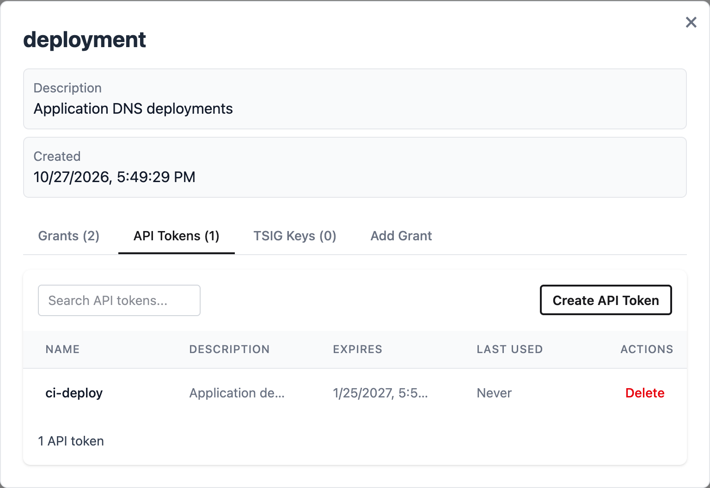

<details>
<summary>API token creation and TSIG key details</summary>

API tokens can expire; their secret is shown only when created. Creating one from a role fixes the role selection for you.

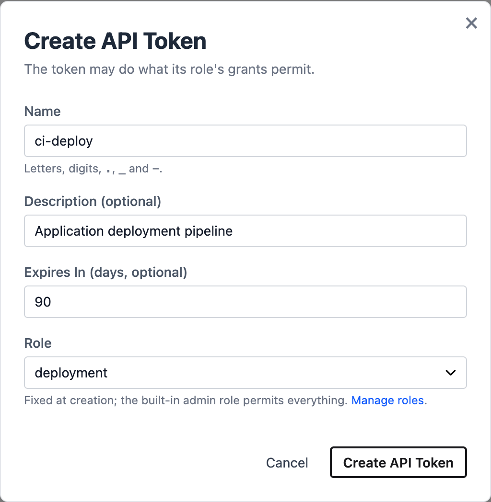

Generate or import TSIG keys for dynamic updates and zone transfers. Existing key secrets can be revealed or copied, and the key's details link back to role management.

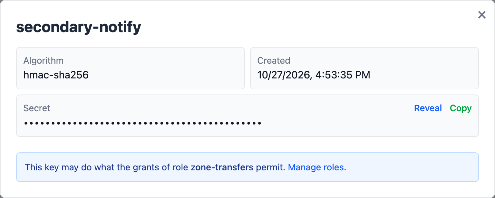

</details>

## Audit log

Review role, grant and credential changes alongside secondary and DNSSEC policy administration, filtered by entity, name or date. Reading the log requires `audit:read`; zone and record edits remain in the zone's version history.

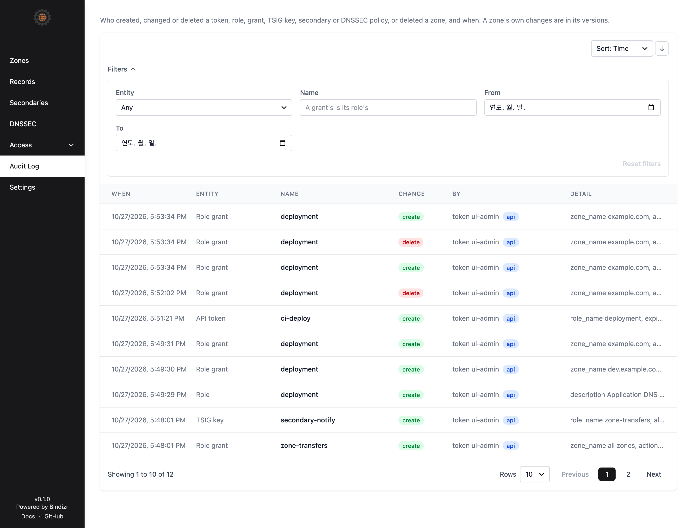

## Run with Docker

```bash
docker run -d --name bindizr-ui -p 9000:9000 kweonminsung/bindizr-ui:0.1.0
```

Or with Docker Compose:

```bash
docker compose up -d
```

Then open <http://localhost:9000>.

Run Bindizr separately. In the setup screen, enter its URL as reachable from the UI server, provide an API token if required, and test the connection. The token's role determines the available pages and actions; an optional UI admin account protects access to this UI instance.

A `v*` tag, or the Manual Release workflow, builds and pushes the amd64 and
arm64 image; the Publish Image workflow pushes it under a tag you enter. To
push it from your own machine instead (the tag defaults to the version in
`ui/package.json`; `IMAGE` overrides the repository):

```bash
./scripts/build_image.sh
```

## Getting Started

Run these commands from the repository root.

1. **Install dependencies and create the initial frontend build:**

   ```bash
   go mod download
   npm --prefix ui ci
   npm --prefix ui run build
   ```

2. **Start Vite in one terminal:**

   ```bash
   npm --prefix ui run dev
   ```

3. **Start the Go server in another terminal:**

   ```bash
   GO_ENV=development go run .
   ```

Open <http://localhost:9000>. The Go server forwards frontend requests to Vite on port 9001 and handles the local API and Bindizr proxy.

## Dependencies

- [Go](https://golang.org/) v1.27.3 or higher
- [Sqlite3](https://sqlite.org/)
- [Node.js](https://nodejs.org) v24 or higher
- [React](https://reactjs.org/) v19
- [Tailwind CSS](https://tailwindcss.com/) v4
- [Bindizr](https://github.com/kweonminsung/bindizr)
